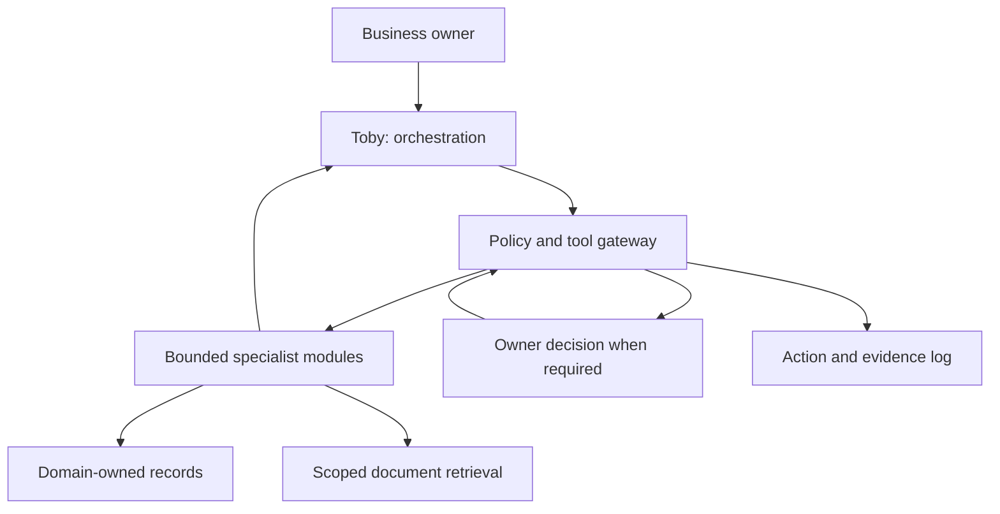

# Architecture

## Implemented synthetic delegation extension — 29 October 2026

Validated chat messages first pass a full-message deterministic allowlist. The supported
one-batch brownie affordability request routes to `orchestrator/delegation.py` and the
server-owned `workflows/synthetic_delegation.py` setup. Other brownie affordability
requests receive a scope explanation without invoking tools or the provider. General
conversation retains its existing model path and unsupported-action checks.

This route calls existing recipe resolution, Bobathan ingredient availability and
Saul affordability. It does not call the full 13-piece workflow or invent new specialists.
Server-owned paths and a synthetic principal grant only those three read capabilities.
Real completion receipts, scope and request identities are checked before accepting
findings. The summary is deterministic; no model receives these results automatically.
The decision cannot become approval while recipe-to-proposal costing is missing.

An observing audit sink first persists each real application event. Only successful
specialist authorisation emits a started event; only a validated handoff emits a
successful result event. Denial or audit failure does not illuminate a working gem.
The bridge flushes bounded ASCII NDJSON over the same POST; no jobs, polling, retries,
WebSockets or persistent sessions are introduced. The browser enforces sequence,
request and state transitions and handles interruption without manufacturing completion.
Existing demo replay uses its separate unchanged route. See
[protocol, browser checks and limits](LOCAL_TOBY_INTERFACE.md).

The initial conversation-only design below describes the preceding increment; the
new synthetic dispatcher is the sole exception to its no-delegation boundary.

## Initial conversation extension — 29 October 2026

The loopback bridge now has a separate `/api/chat` endpoint. A dedicated Toby
conversation service validates a bounded public/synthetic transcript and calls the
existing text adapter. The browser retains at most six exchanges/8000 context characters
in tab memory. General conversation has no business readers or model-generated tools.
The only specialist routes are the separately allowlisted synthetic brownie review and
the exact public Halloween research question sent to Percival. Client history is
untrusted content; only server-owned instructions describe model capabilities. The
provider can return text only. Offline help and input/output guards are application code;
they are not guarantees of arbitrary-text privacy or accuracy.

The explicit brownie button uses the unchanged audited workflow and explanation path.
Chat history excludes demo outputs and browser bakery records. See
[local conversation details and evidence](LOCAL_TOBY_INTERFACE.md).

## Implemented local interface extension — 29 October 2026

A loopback HTTP bridge serves the existing interface and fixed synthetic brownie
workflow. The workflow remains deterministic and offline. Its audited internal
result feeds a separate Toby presentation layer, optionally using the unchanged
Nebius text adapter. No client-supplied identity, records, tool calls or result
envelopes are accepted. Model text cannot alter domain results or execute actions.
See [local Toby interface](LOCAL_TOBY_INTERFACE.md) for mode controls, verification
and the outstanding browser/live-provider checks. This is not a hosted front door.

## Implemented local extension — 7 October 2026

The existing modular/domain-owned design now includes Tibbi, version-pinned recipe
lookup and ingredient/finished-stock collection reads. A temporary deterministic
brownie-order workflow coordinates these and existing Saul/Galgali tools under Toby.
It owns no domain records and contains no model or external-action interface.
See [local brownie foundations](LOCAL_BROWNIE_FOUNDATIONS.md) for ownership and
explicitly unfinished production/fulfilment stages. New read capabilities reuse the
existing policy and audit infrastructure; existing applications were not refactored.

The sections below retain the earlier deployment proposal. September wording about
absent Toby/provider adapters is historical; README and STATUS describe current code.

## Proposed deployment shape
Start with a modular Python application and a local development interface. A strand is a logical capability with a bounded tool interface; it need not be a separate model, process or cloud service. Use deterministic calculations for quantities, money and scheduling constraints. Introduce specialist LLM calls only where language interpretation benefits the task.

## Request lifecycle
1. Resolve operator, business and request ID in the application, never from a model's unverified claim.
2. Toby identifies relevant capabilities and requests only the necessary reads.
3. The gateway checks domain access, tool allowlists and business scope before executing.
4. Specialists return structured facts, source references, timestamps, uncertainties and proposed actions.
5. Toby combines results, detects conflicts and missing data, and explains the recommendation.
6. A proposed write passes authorization and, where policy requires it, owner approval. The owner-approved payload is bound to its exact values and current record versions.
7. The domain tool validates and applies the change, returning a receipt. An audit entry records the outcome.

## State and responsibilities
Authoritative business records live in domain storage, not model memory or a vector index. Toby can request cross-domain business views through tools. Specialists cannot directly query each other's tables; they ask Toby for a bounded dependency result. All data requests carry business scope even while the prototype supports only one business.

Scheduled cash events cross the finance/time boundary without duplicating ownership. Saul's finance record is authoritative for the amount, direction, category and settlement status. Galgali holds the linked calendar entry and owns its due/expected time.

For a date-sensitive affordability question, Toby requests both bounded views. Toby identifies Galgali items that fall within the decision window and flags anything relevant that is absent from or conflicts with Saul's finance view. If the Galgali check is unavailable, fails or is incomplete, Toby returns a qualified result; it must not reinterpret missing calendar evidence as “nothing due”.

Saul's first operator-facing data tool is a private spreadsheet with a balance snapshot, ledger, commitments and proposals. It exists as a verified standalone workbook, not as an application database or permission boundary. The Python runtime uses a bounded read-only workbook adapter and keeps integer-penny finance logic separate from file handling.

The local application boundary now authorizes the configured actor, business and named capability before constructing that adapter. It writes append-only authorization and completion events to a private JSONL audit file and fails closed if the authorization event cannot be recorded. The CLI principal is application configuration, not end-user request data. Hosted authentication and a multi-user identity provider remain unimplemented.

Galgali now has a parallel local boundary for the financial calendar. His private workbook records a confirmed coverage window and bounded dated event rows. The deterministic service filters scheduled events into a requested window and returns incoming, outgoing and net totals in integer pennies. It distinguishes a confirmed empty window from an unconfirmed or incomplete one. Galgali and Saul do not read each other's workbooks; later Toby orchestration will request each authorized result and compare the linked IDs.

Bobathan's first local boundary reads one size-limited, business-scoped JSON document containing synthetic ingredient stock and caller-supplied requirements. His deterministic service subtracts reservations, compares only identical units and returns available, shortage or unknown per item with evidence references. Counted zero remains distinct from missing or explicitly unknown stock. Packaging, inventory writes, recipe retrieval and unit conversion are outside this milestone.

SQLite remains the proposed first application storage for synthetic transactional data and must be selected formally before implementation. The workbook will remain the human-readable finance view; its longer-term import/synchronization relationship with structured storage must be decided before both can accept writes. Start RAG with a small versioned document corpus and the simplest retrieval baseline; add embeddings/vector infrastructure only after measured need and hackathon requirements are understood.

## Cross-domain updates
Do not pretend an order, stock reservation and calendar booking form an atomic operation across unrelated services. Begin with one local transaction where practical. If adapters later require separate transactions, use a persisted workflow with idempotency keys, explicit pending states and compensating releases. Report partial failure clearly; never claim completion until all required receipts exist.

## Provider boundaries
Nemotron adapter handles Toby's conversational model calls. Percival's bounded public Halloween-research route uses the server-side Tavily Search adapter; its fixed query and normalized source findings do not pass through Nemotron. Storage/retrieval adapters handle business facts and documents. The Tavily REST endpoint and bearer authentication follow the [official Tavily Search API reference](https://docs.tavily.com/documentation/api-reference/endpoint/search). Lisa reports that live Tavily search works; the full Montgomery chain remains to be verified.

The exact Percival-to-Montgomery route passes up to five normalized public search
findings to Montgomery's social-draft function. When the existing Nebius model adapter
is explicitly enabled, it receives only those source findings and returns bounded draft
text; otherwise the interface labels a fixed offline template as not AI-generated.
There is no publish or social-account tool.
